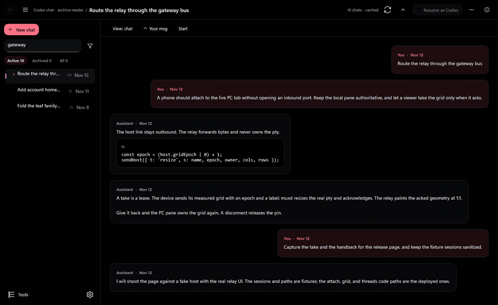

# MUX

**One archive for the Codex and Claude Code session files on one PC, and a browser terminal that reaches the live session.**

MUX indexes the session files that Codex and Claude Code already write, so a chat from months ago resurfaces, reads cleanly, and reopens in the terminal where it started. A PC-side host (`muxd`) and a VPS relay carry those same terminals to a browser, and keep them alive when the network drops.



## What is in the repo

| Part | Job | Entry point |
| --- | --- | --- |
| `app/` | WinUI 3 desktop archive: index, read, organize, search, resume | `app/native/CodexLocalRetrieval.Native` |
| `muxd/` | PC-side ConPTY host; owns the real terminals and dials out | `muxd/muxd.py` |
| `relay/` | Express + WebSocket relay and browser terminal on a VPS | `relay/server.js` |

`app/` arrived by subtree from the local-retrieval repo, and `muxd/` and `relay/` from the multiplex repos, so each directory keeps its own history.

## How it works

The app scans `~/.codex/sessions` and `~/.claude/projects` on launch, parses each format, and re-reads only files that changed. Claude chats key on the transcript filename, which is also the id `claude --resume` needs, and sidechain transcripts are skipped. Pins, projects, and renames live in an app-owned store, so a re-sync never rewrites your source `.jsonl` files.

`muxd` owns one ConPTY per session on the PC and dials out to the relay over a single WebSocket. The PC needs no inbound port, and a Wi-Fi drop or relay deploy only makes viewers reattach. The relay mirrors sessions, strips its own element-map escape sequence before the browser sees the stream, and keeps durable state for projects and pins. Write leases live in `muxd`, so the relay never decides who may type.

The desktop app reads `live-tabs.json` and walks a process's ancestor pids to link a running `codex` or `claude` process to its real tab. That link is deterministic, so a shell-launched agent can join a collection or relaunch by its chat id without guessing from folder names.

The main limit is the platform: the desktop app and `muxd` target Windows, because both depend on WinUI 3 and ConPTY.

## Run it

```powershell
git clone https://github.com/asajid2-cell/local-retrieval.git
cd local-retrieval/app/native/CodexLocalRetrieval.Native
dotnet run -c Debug
```

Requires Windows 10 or 11 and the .NET 8 SDK. On first launch the app indexes both default session stores; add another folder in Settings → Sources.

## What you can do

- **Resurface old chats.** Launch re-scans both stores, so a conversation from months ago is back in the list.
- **Read it clean.** The reader strips IDE, environment, and system-reminder boilerplate.
- **Organize.** Chats group by project path; file one into a named project, or pin it. Organization survives every re-sync.
- **Resume.** One action runs `codex resume` or `claude --resume` in the chat's original working directory.
- **Ask a co-pilot.** A DeepSeek-backed tool loop searches and organizes the archive, with a confirmation step before any change.
- **Reach it from a phone.** The headless `CodexLocalRetrieval.Server` serves a bearer-authenticated web UI through your own reverse proxy.

## Where to look

| Area | Path |
| --- | --- |
| Indexing, parsing, sync, resume | `app/native/CodexLocalRetrieval.Core/Services/ArchiveService.cs` |
| App shell and navigation | `app/native/CodexLocalRetrieval.Native/MainPage.xaml.cs` |
| Co-pilot tool loop | `app/native/CodexLocalRetrieval.Core/Chat/` |
| Remote API and auth | `app/native/CodexLocalRetrieval.Core/Remote/` |
| Session host | `muxd/muxd.py` |
| Relay and browser terminal | `relay/server.js`, `relay/public/` |
| Element-map contract | `docs/terminal-element-map.md` |

Run the app suite with `dotnet test app/native/CodexLocalRetrieval.Native.Tests`, and the relay suite with `npm test` in `relay/`.

## Deploy

`scripts/deploy-muxd.ps1` copies `muxd/` to `%USERPROFILE%\muxd-runtime` and restarts the `MuxdSessionHost` task. `scripts/deploy-relay.sh` packages an exact commit for the VPS installer. The runtime directory is a deploy target and state root, never a checkout; edit `muxd/` here.

## Limitations

- The desktop app and `muxd` run on Windows only, because both depend on WinUI 3 and ConPTY.
- The portable build is unsigned; Windows SmartScreen warns on first launch.
- Remote access needs your own VPS, TLS, and a bearer token of at least 24 characters. The server binds `127.0.0.1` by default.
- The co-pilot needs `DEEPSEEK_API_KEY`; without it, chat is disabled.
- Source `.jsonl` files are never modified, so organization lives only in the app store.
- MUX is unofficial and not affiliated with OpenAI or Anthropic.

## Status and license

Active development on `main`; the desktop release notes track v0.2.0 in `app/RELEASE_NOTES.md`. The desktop app is MIT (`app/LICENSE`); the relay package declares ISC.

Read `app/CONTRIBUTING.md` and run both suites before a pull request.
