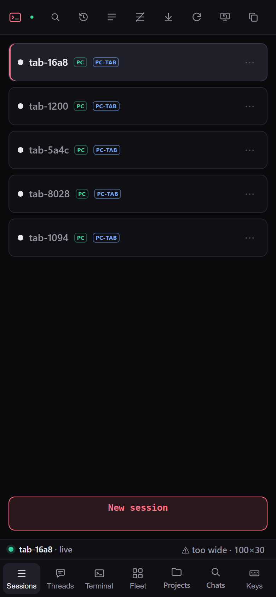
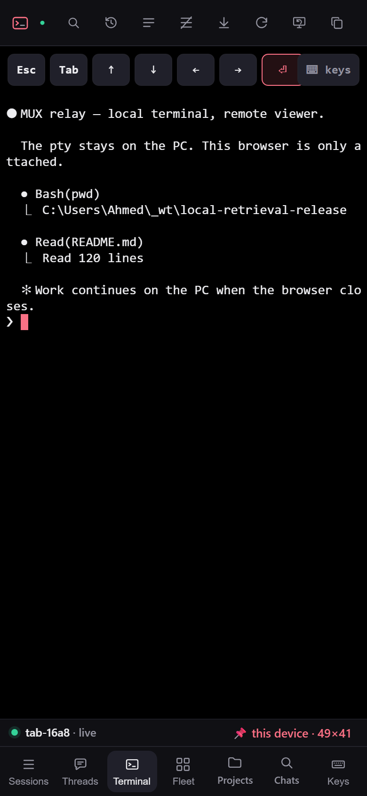
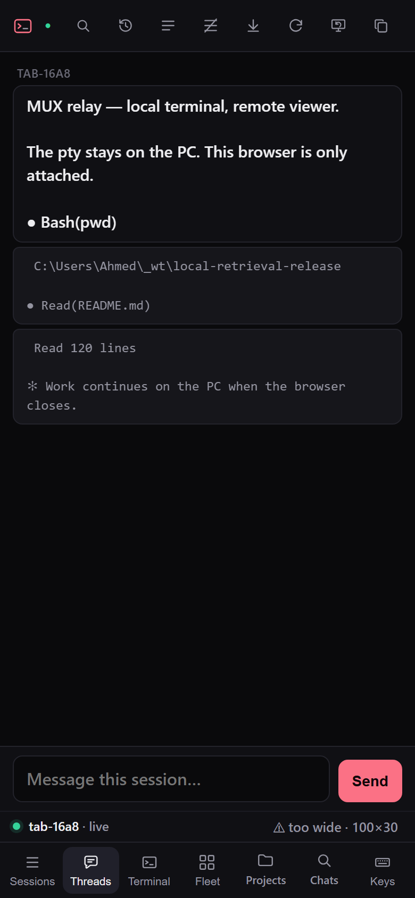
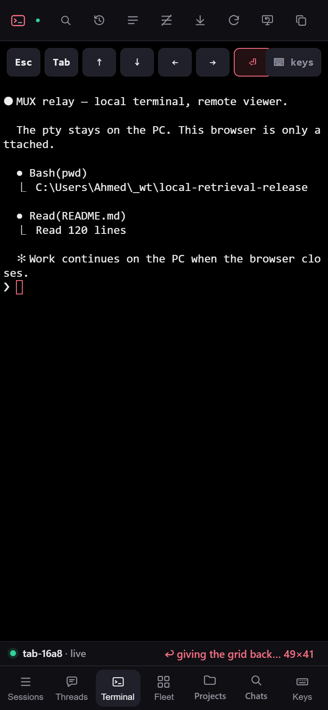

# MUX

**One searchable archive for the Codex and Claude Code sessions on a PC, with a browser terminal that attaches to the live ones.**

MUX puts both agent-session stores into one searchable archive. It reopens any chat in the terminal where it started, and it carries that terminal to a browser without opening a port on the PC. The desktop app, the PC-side session host, and the VPS relay ship in one repo.


## The result

| Result | Evidence |
| --- | --- |
| Two session formats in one archive | Codex rollouts and Claude transcripts, parsed by `app/native/CodexLocalRetrieval.Core/Services/ArchiveService.cs` |
| Three processes in one repo | `app/`, `muxd/`, `relay/` |
| 1,700+ automated tests | `app/native/CodexLocalRetrieval.Native.Tests`, `relay/tests` |
| Zero inbound ports on the PC | `muxd/muxd.py` dials out to the relay |
| One grid, one owner at a time | an epoch, an owner label, and an acknowledged resize |

## What I built

I built the archive engine, the WinUI 3 client, the co-pilot tool loop, the ConPTY session host, and the relay. The hard part is the live file: the session you most want to resume is often still being written, in one of two formats, with subagent transcripts mixed in. The parser streams it, keys each chat on its resumable id, and an incremental cache keeps a re-scan off files that did not change.

## How the archive works

The app scans `~/.codex/sessions` and `~/.claude/projects` on launch and routes each file by format. Claude chats key on the transcript filename, which is also the id `claude --resume` needs, and sidechain transcripts are skipped. Pins, projects, and renames live in an app-owned store, so a re-sync never rewrites a source `.jsonl` file.

The obvious alternative is SSH plus tmux. That needs an inbound path or a permanent tunnel to the PC, and a Unix host. `muxd` dials out instead, and owns Windows ConPTY directly.

## The relay: local work, remote view

An attached browser drives the real pty that is already running on the PC. The tee keeps ownership of that pty, and `muxd` streams its bytes to the VPS over one outbound WebSocket. The relay forwards viewer input back and fans output to each viewer. The PC needs no inbound port, so closing the browser or losing the network does not stop the work.

The relay is a forwarder, not a source of truth. A session with a PC chip is running on the PC and survives a relay deploy or a network drop; reattaching returns to the same session. The archive, the keys, and the terminal stay on the machine.

The grid is the one shared piece. A pty has one physical grid, cols × rows, and the PC pane owns it by default. A device that wants it sends an epoch, an owner label, and the cols and rows it reads at its font. Then `muxd` resizes the pty and acknowledges the new geometry.

## One grid, one owner

The relay paints only the acknowledged geometry, at 1:1, with no scaling. A take is a lease, not a mode. Give it back and the PC pane owns the grid again, while a newer epoch from another device supersedes the old one. If the pinning device disconnects, the relay releases the grid back to local.

A viewport change while you hold it reads a new grid instead of stretching the old one. That is the point of local-first: work continues whether or not anyone is attached. The browser is an attachment, not a copy of the screen, and a remote viewer cannot quietly change the terminal the PC is using.

## Threads on a phone

Agent TUIs repaint in place with absolute cursor addressing, so the byte stream has no scrollback. The threads view builds a conversation client-side from the live text: up to 400 messages or 400,000 chars per session, de-duplicated across updates and kept over reconnects. It has its own composer, so a phone reply never needs the grid or the key bar.

| Sessions on the phone | The phone takes the grid |
| --- | --- |
|  |  |
| **Threads view** | **Handing the grid back** |
|  |  |

## Try it

```powershell
git clone https://github.com/asajid2-cell/local-retrieval.git
cd local-retrieval/app/native/CodexLocalRetrieval.Native
dotnet run -c Debug
```

Requires Windows 10 or 11 and the .NET 8 SDK. On first launch the app indexes both default session stores; add another folder in Settings → Sources.

## What it does

- **Resurface old chats.** Launch re-scans both stores, so a conversation from months ago is back in the list.
- **Read it clean.** The reader strips IDE, environment, and system-reminder boilerplate.
- **Organize.** Chats group by project path; file one into a named project, or pin it. Organization survives every re-sync.
- **Resume.** One action runs `codex resume` or `claude --resume` in the chat's original working directory.
- **Ask a co-pilot.** A DeepSeek-backed tool loop searches and organizes the archive, with a confirmation step before any change.
- **Attach from a phone.** The relay lists the live PC tabs and drives the real terminal from a browser.

## Where the substance is

| Area | Path |
| --- | --- |
| Indexing, parsing, sync, resume | `app/native/CodexLocalRetrieval.Core/Services/ArchiveService.cs` |
| App shell and navigation | `app/native/CodexLocalRetrieval.Native/MainPage.xaml.cs` |
| Co-pilot tool loop | `app/native/CodexLocalRetrieval.Core/Chat/` |
| Remote API and auth | `app/native/CodexLocalRetrieval.Core/Remote/` |
| Session host | `muxd/muxd.py` |
| Relay, browser terminal, and grid | `relay/server.js`, `relay/public/index.html` |
| Relay test fixtures | `relay/tests/harness.js` |
| Element-map contract | `docs/terminal-element-map.md` |

Run the app suite with `dotnet test app/native/CodexLocalRetrieval.Native.Tests`, and the relay suite with `npm test` in `relay/`.

## Limitations

- The desktop app and `muxd` run on Windows only, because both depend on WinUI 3 and ConPTY.
- The portable build ships unsigned; Windows SmartScreen warns on first launch.
- Remote access needs your own VPS, TLS, and a bearer token of at least 24 characters. The server binds `127.0.0.1` by default.
- The co-pilot needs `DEEPSEEK_API_KEY`; without it, the app disables chat.
- One device owns the grid at a time. A second device can take it, but the PC pane and the phone cannot both resize the same pty.
- The threads view keeps up to 400 messages per session and is a reading and composing surface, not a full TUI replacement.
- The app never modifies a source `.jsonl` file, so organization lives only in the app store.
- MUX is unofficial and not affiliated with OpenAI or Anthropic.

## Status and license

Development continues on `main`; this branch is the release cut, and it includes the relay and grid work. The desktop release notes track v0.2.0 in `app/RELEASE_NOTES.md`. The desktop app is MIT (`app/LICENSE`); the relay package declares ISC.

Read `app/CONTRIBUTING.md` and run both suites before a pull request.
